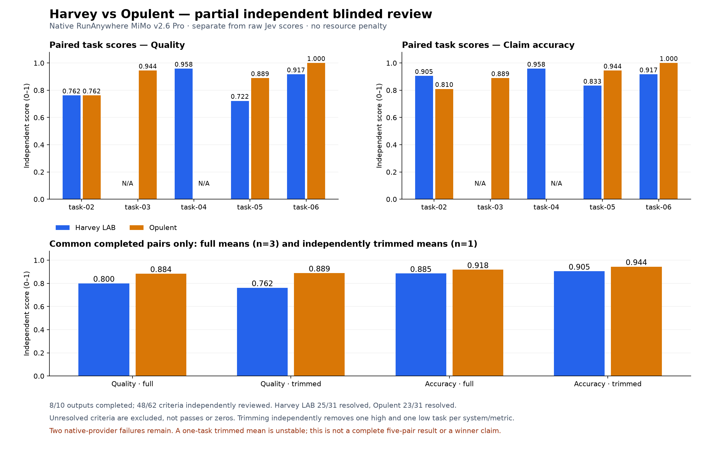

# Native MiMo capability v7.1 — explicitly partial comparison

Eight of ten fresh outputs completed. **Harvey task-03 and Opulent task-04 each failed three retained attempts on native RunAnywhere 503s.** A minimal native health request also returned `gateway_unavailable`; one later health success did not prevent renewed task failures. No Gateway answerer substitution occurred. The two missing outputs require provider recovery; this is not a completed five-pair comparison.

## Direct paired scores and independent trimming

The primary comparison uses only the **three common completed pairs: tasks 02, 05 and 06**. Scores are 0–1, with equal criterion weight within each task and equal task weight across tasks; no token, time or turn penalty is imposed. Independent trimming removes one lowest and one highest task separately per system and metric, leaving **one** task score, not the requested final three. Ties use task ID. This trimmed pilot is unstable and cannot establish a general winner.

### Evidence-grounded blinded review: common pairs

| Metric | Harvey full | Opulent full | Harvey trimmed | Opulent trimmed |
| --- | ---: | ---: | ---: | ---: |
| Quality | 0.800 | 0.884 | 0.762 | 0.889 |
| Claim accuracy | 0.885 | 0.918 | 0.905 | 0.944 |

| Task | Harvey reviewed quality / accuracy | Opulent reviewed quality / accuracy |
| --- | ---: | ---: |
| task-02 | 0.762 / 0.905 | 0.762 / 0.810 |
| task-03 | N/A / N/A | 0.944 / 0.889 |
| task-04 | 0.958 / 0.958 | N/A / N/A |
| task-05 | 0.722 / 0.833 | 0.889 / 0.944 |
| task-06 | 0.917 / 0.917 | 1.000 / 1.000 |

### Unchanged raw Jev: common pairs

| Metric | Harvey full | Opulent full | Harvey trimmed | Opulent trimmed |
| --- | ---: | ---: | ---: | ---: |
| Quality | 0.964 | 0.964 | 0.957 | 0.964 |
| Claim accuracy | 0.877 | 0.871 | 0.869 | 0.879 |

Jev produced 48 valid HTTP-200 decisions on the eight completed outputs, with no judge failures or unresolved decisions. It marked 47/48 satisfied; fourteen missing-output criterion rows remain `answererFailure`, not zero grades. Independent blinded review covers all 48 available criterion-output combinations: **34 pass, 14 fail and 0 unresolved**, with 15 satisfaction disagreements. Raw Jev requests, responses and scores remain unchanged; review ordinals divided by three are separate diagnostics, not replacement provider outputs or lawyer certification.

| Record | System | Metric | Retained | Dropped low / high |
| --- | --- | --- | --- | --- |
| Jev common pairs | Harvey LAB | quality | task-05 | task-02 / task-06 |
| Jev common pairs | Harvey LAB | accuracy | task-05 | task-02 / task-06 |
| Jev common pairs | Opulent | quality | task-06 | task-02 / task-05 |
| Jev common pairs | Opulent | accuracy | task-02 | task-06 / task-05 |
| Review common pairs | Harvey LAB | quality | task-02 | task-05 / task-06 |
| Review common pairs | Harvey LAB | accuracy | task-02 | task-05 / task-06 |
| Review common pairs | Opulent | quality | task-05 | task-02 / task-06 |
| Review common pairs | Opulent | accuracy | task-05 | task-02 / task-06 |

Every retained/dropped set is in the policy summary and CSVs. The [secondary raw chart](results/native-mimo-v26-pro-capability-v71-partial-20261003/comparison-partial-jev.png) and raw available-output CSVs use four task scores per system, but **different task sets**. Their means are not a paired comparison. Secondary independently reviewed available-output means, preserved for completeness, are:

| Metric | Harvey full | Opulent full | Harvey trimmed | Opulent trimmed |
| --- | ---: | ---: | ---: | ---: |
| Quality | 0.840 | 0.899 | 0.839 | 0.917 |
| Claim accuracy | 0.903 | 0.911 | 0.911 | 0.917 |

## What the reviewed evidence shows

| Task | Harvey pass / fail / unresolved | Opulent pass / fail / unresolved |
| --- | ---: | ---: |
| task-02 | 2 / 5 / 0 | 4 / 3 / 0 |
| task-03 | N/A — provider failure | 6 / 0 / 0 |
| task-04 | 7 / 1 / 0 | N/A — provider failure |
| task-05 | 3 / 3 / 0 | 5 / 1 / 0 |
| task-06 | 3 / 1 / 0 | 4 / 0 / 0 |

Reviewers used anonymized amber/slate packets with complete frozen requirements, public hypothetical materials, authoritative references and replay-verified parent-visible source bodies. They did not receive the arm map or Jev scores. Every response has exactly verified JavaScript UTF-16 answer/source/fact coordinates and immutable packet/output hashes. Hidden reference authority establishes legal truth, never consultation. Failure to find a body in the replay inventory is not certified absence from the entire underlying corpus. Transaction uncertainty requested by the rubric is not automatically an unresolved grade.

- Task-02 exposes branch selection, asset-versus-liability fallback, company-form scope and evidence-readback defects. One memo excludes the express without-dissolution absorption branch by relying on older whole-estate/extinction wording; the other gives a proportional fallback for an unallocated liability. Both narrow the SARL articles exception by importing or assuming stricter-only requirements. Correct dividend and branch assertions can still fail explicit consultation requirements when the consequential cited body was not replay-visible. Shared defect IDs preserve the distinction between affected criteria and root causes.
- Task-03's completed memo passes all six minimum requirements, with limited ordinal deductions for unnecessarily provisional recognition and unsupported payment-maturity assertions. Unseen exact citations were not credited, but alternative visible dividend/accrual bodies support the required cut-off conclusions; the blanket consultation claim is not certified.
- Task-04's completed memo correctly includes former Mara and recruited Leon, but its operative collection instruction cuts granted-or-due remuneration to service windows rather than the whole recent financial exercise. This is a bounded scope error, not an allegation that an undisclosed payment actually exists.
- Task-05 separates current SARL-S law, dated Belgian comparative literature, unknown actual voting and the cross-border effective-date rule. Remaining defects include adequate-initial-resource omission, attributing the autonomous 2011 listed-company vote regime to the 1915 Act, and an additional amendment claim lacking a visible supporting body. That collateral amendment's truth remains unknown, not disproved; the source requirement is still assessably unmet.
- Task-06's failing memo imports a liquidation-specific SCS majority into the general contribution-change framework, manufacturing a conflict that the full read article resolves. Its correct numerical corporate results and correct refusal to approve Sol are retained rather than scored as false.

Full dispositions, including task-03, are in [the policy summary](results/native-mimo-v26-pro-capability-v71-partial-20261003/summary.json) and the private validated review archive. [Disagreement records](results/native-mimo-v26-pro-capability-v71-partial-20261003/alignment-disagreements.csv) preserve exact reasons and shared defect identities. These failures support checking statutory chapter, company form, consolidation date and full operative text before accepting a source or child conclusion; they do not establish an embedding/ranking cause or a controlled improvement over historical results.

## Actual RLM, codemode, VM and skill adoption

| Completed Opulent task | Successful / requested kernel cells | Successful / requested scripts | Material-read intervals overlap | Completed research children | Children with actual VM |
| --- | ---: | ---: | --- | ---: | ---: |
| task-02 | 14 / 16 | 2 / 2 | yes | 3 | 2 |
| task-03 | 7 / 7 | 0 / 2 | no | 3 | 0 |
| task-05 | 8 / 9 | 2 / 2 | no | 3 | 2 |
| task-06 | 9 / 10 | 3 / 3 | yes | 3 | 1 |

All four completed Opulent leads used the real kernel and completed three bounded research children each. **Five of twelve completed children provisioned distinct VMs; seven stayed host-tool-only.** Queued IDs and spawn dispatch alone are not counted as VM-backed completion. Bound parent `rlm.result` outputs and the original trajectories preserve completed readbacks, including model-selected output clipping; child-only and unprinted evidence is not credited to the parent.

The startup material batch succeeded with actual printed bodies and overlapping read intervals on tasks 02 and 06. Task-05 loaded its materials successfully but sequentially. Task-03's two codemode scripts failed on a duplicated material-path prefix and the unsupported scripted `tools.call` positional form; it recovered through direct tools and RLM, not a successful codemode startup. Failed cells and recoverable tool outcomes remain visible.

Persistent kernel availability is proved, but the scored leads did **not** reuse initialized source registries/research notes across later cells; many later cells re-created values or hardcoded returned child IDs. Real RLM calculation/orchestration is not evidence of complete adherence to the requested retained-reasoning-state procedure. Applicable management/analysis procedures were invoked; task-03 omitted `data-analysis` despite quantitative materials. A procedure-text readback does not prove every prescribed step was followed.

All 26 captured Opulent sessions across seven retained attempts contain the exact v7.1 supplement. All-attempt tool distribution, configured/permitted tools and definition hash are in the summary; they are separated from model-surface requests, nested dispatch outcomes and error-valued returns. Unconfigured external providers and excluded blueprint/voice/wiki/repository-Q&A/user-management/settings scope were not bypassed. Harvey's upstream behavioral instructions and tool architecture remain unchanged apart from the separately versioned public-task policy correction.

## All-attempt resources and lifecycle

| System | Retained attempts | Observed input | Observed output | Cached input subset | Matched settled USD | Unknown physical attempts |
| --- | ---: | ---: | ---: | ---: | ---: | ---: |
| Harvey LAB | 7 | 8,605,251 | 278,346 | 8,073,216 | 0.625200 | 46 |
| Opulent | 7 | 35,053,639 | 438,866 | 33,145,216 | 1.724710 | 48 |

All **fourteen retained attempts**, including six failed attempts and their captured descendant requests, are counted exactly once. Native settlement uniquely joins all 556 captured response IDs, matches every reported model/time/prompt/completion/cache count, and excludes 96 unmatched account rows. The matched settled subtotal is **USD 2.349910**, not total billed experiment cost: **94 physical attempts have unknown usage**, no retained attempt has complete billing coverage, and late or uncaptured activity is not assigned by time/token similarity.

Cache is an input subset. The 554 chat-versus-settlement reasoning-counter disagreements are retained separately; reasoning is not added as an extra billable category. Catalogue arithmetic is an estimate, not an invoice. Parent/child usage is rolled into Opulent once, with unequal aggregate compute by design. Attempt wall sums are 99.54 Harvey and 99.74 Opulent minutes; these are neither elapsed concurrent-batch time nor E2B billable duration.

The separate Jev run reports 998,475 input and 5,184 output tokens, and **USD 0.041935950 provider-reported**, without independent Gateway settlement. Retrieval embedding/reranking/database charges, E2B CPU/RAM/invoices, native health/preflight probes and host engineering/Capy review charges remain unknown or separately scoped, not zero.

All 19 recorded scored-attempt parent/child VMs were independently confirmed absent with the E2B SDK's typed sandbox-not-found result. This fresh all-attempt union includes earlier failed VMs, not only each arm's final attempt. All captured Opulent sessions are settled and nonactive; unused research in failed runs is explicitly cancelled. API kill receipts alone are not treated as absence. Task-01 verification VMs remain a separate unscored scope.

## Provenance, verification and historical separation

- Scored code: `7e1fd8eef8750799542df7536d43cd9082b50d06`; separate capability protocol `opulent-capability-v7.1`; normalized addendum SHA-256 `99924d28fadec98b6b9416ed6897e7c832b9d2a544ece68c9b759f13943d9329`. The separately recorded file-byte SHA-256 is `0ce64ca581da61df07295f8a991451cb5da7cb36a3f58183ac1fc48f5e9bfd5c`; these use different whitespace boundaries, not different instructions.
- Terminal partial checkpoint SHA-256: `cf358af22546e0e9861fb29f3006b5ad1782c3f87018d2e03e7e9f1aa9610bf0`; frozen suite SHA-256 `2cb2dc9ebd69d006354785c26475f0673988a485fb009ae8fda5ea3facb09afc`. Tasks, corpus, rubric, historical grades, first-pass records and both failed retry snapshots remain unchanged.
- Answerers and descendants use native `mimo-v2.6-pro` at `https://inference.runanywhere.ai/v1`, provider-default sampling/reasoning, 1,000 parent steps, 32,768 completion tokens per request, 600-second model deadline and 3,600-second sandbox lifetime. All ten first-pass arms were dispatched concurrently; later recovery resumed only the two failed arms. No artificial child-depth, child-concurrency or host/script-call quota was imposed. These are not equal-total-compute runs.
- Harvey template `vj9cdw6z2kti276qs60r`; Opulent template `aacky3169dfjvjyw7bsu`. Exact effective tool definitions, enabled capabilities, provider availability and installed instruction/skill hashes remain in private provenance. Tool registration does not certify a live provider.
- Jev `typesafe-ai/jev` is separately provider-pinned through the evaluate endpoint; evidence/request/raw-response bindings and replay implementation hashes remain immutable. Independent reviews ran on host `openai/gpt-6.1-sol` max/fast, not on the answerer model.
- Live-derived source fixes passed 39 lifecycle/RLM and 58 replay/grading checks, plus typecheck and whitespace checks before answering. Publication revalidates native settlement, every retained artifact/deliverable, final Opulent assistant hashes, exact review coordinates, source inventories, cached Jev bindings, score arithmetic and trim sets. The task-01 protocol gate is not a scored quality claim.

The public report contains only derived scores, counts, reasons and policy. The private evidence bundle retains raw trajectories, actual corpus excerpts, blinded packets, raw Jev captures, settlement joins, lifecycle proofs and SHA-256 manifests; licensed material and credentials are not public PR assets. Earlier v6/native/Gateway reports and the named closed-corpus baseline remain separate, unchanged experiments. **No final five-pair winner or total-cost claim is made, and no merge is performed.**
