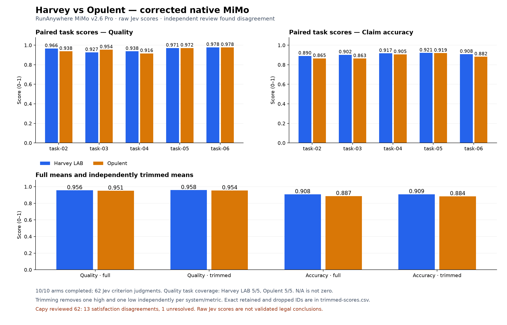
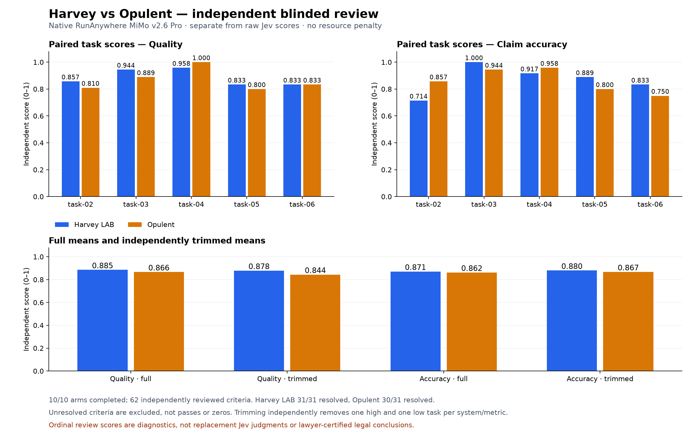

# Native RunAnywhere MiMo v2.6 Pro — five-task comparison

All ten corrected answerer arms completed and all ten declared memos were collected and hash-verified. Jev returned 62 valid HTTP-200 criterion judgments, but its satisfaction decisions are **not legally aligned**: independent blinded review found 13 failures and one unresolved criterion. High raw scores must not be reported as an all-pass legal result or a reliable winner claim.

## Scores and independent trimming

Each score is on a 0–1 scale. Within each task, criteria have equal weight; across tasks, tasks have equal weight. Quality/completeness and asserted-claim accuracy are separate. No token, time or turn penalty is applied. Missing claims never receive perfect accuracy. Trimming removes exactly one highest and one lowest **task** score independently per system and metric, leaving three task scores; task ID breaks exact ties. Both the full paired results and every retained/excluded set are preserved.

### Raw Jev scores

| Metric | Harvey full | Opulent full | Harvey trimmed | Opulent trimmed |
| --- | ---: | ---: | ---: | ---: |
| Quality | 0.956 | 0.951 | 0.958 | 0.954 |
| Claim accuracy | 0.908 | 0.887 | 0.909 | 0.884 |

Jev marked 62/62 criteria satisfied at `passProbability >= 0.5`, with no unresolved judgments or provider failures in this final grading run. These are unchanged provider outputs, not corrected legal grades. The raw `grades.json` keeps its original pending-alignment label; the independently bound `alignment.json`, not an edited provider record, contains the completed review.

### Independent blinded review

| Metric | Harvey full | Opulent full | Harvey trimmed | Opulent trimmed |
| --- | ---: | ---: | ---: | ---: |
| Quality | 0.885 | 0.866 | 0.878 | 0.844 |
| Claim accuracy | 0.871 | 0.862 | 0.880 | 0.867 |

These are separate Capy ordinal diagnostics, divided by three, **not replacement Jev responses or lawyer-certified legal opinions**. Reviewers received anonymized amber/slate packets, full frozen requirements/materials/references and actual replay-verified parent-visible source bodies. They did not receive the arm mapping or Jev scores. Every response was validated against its packet with exact JavaScript UTF-16 output/source/fact spans. Unknown legal truth remains unknown; unresolved criteria are excluded from both independent metric denominators, with coverage recorded in the paired CSV. Shared defect IDs distinguish independently affected requirements from distinct root causes.

Resolved independent quality/accuracy coverage is **31/31 criteria for Harvey and 30/31 for Opulent**; all five tasks still contribute task means. Opulent's unresolved task-05 criterion is not treated as a pass, fail, zero or perfect accuracy.

| Task | Harvey Jev quality / accuracy | Opulent Jev quality / accuracy | Harvey reviewed quality / accuracy | Opulent reviewed quality / accuracy |
| --- | ---: | ---: | ---: | ---: |
| task-02 | 0.966 / 0.890 | 0.938 / 0.865 | 0.857 / 0.714 | 0.810 / 0.857 |
| task-03 | 0.927 / 0.902 | 0.954 / 0.863 | 0.944 / 1.000 | 0.889 / 0.944 |
| task-04 | 0.938 / 0.917 | 0.916 / 0.905 | 0.958 / 0.917 | 1.000 / 0.958 |
| task-05 | 0.971 / 0.921 | 0.972 / 0.919 | 0.833 / 0.889 | 0.800 / 0.800 |
| task-06 | 0.978 / 0.908 | 0.978 / 0.882 | 0.833 / 0.833 | 0.833 / 0.750 |

| Scoring record | System | Metric | Low task removed | High task removed | Retained tasks |
| --- | --- | --- | --- | --- | --- |
| Raw Jev | Harvey LAB | quality | task-03 | task-06 | task-04, task-02, task-05 |
| Raw Jev | Harvey LAB | accuracy | task-02 | task-05 | task-03, task-06, task-04 |
| Raw Jev | Opulent | quality | task-04 | task-06 | task-02, task-03, task-05 |
| Raw Jev | Opulent | accuracy | task-03 | task-05 | task-02, task-06, task-04 |
| Independent review | Harvey LAB | quality | task-05 | task-04 | task-06, task-02, task-03 |
| Independent review | Harvey LAB | accuracy | task-02 | task-03 | task-06, task-05, task-04 |
| Independent review | Opulent | quality | task-05 | task-04 | task-02, task-06, task-03 |
| Independent review | Opulent | accuracy | task-06 | task-04 | task-05, task-02, task-03 |

## Legal alignment and trajectory findings

The complete review covers 62/62 criterion-arm combinations: 48 pass, 13 fail and 1 unresolved. There are 13 resolved satisfaction disagreements and one unresolved-status disagreement with Jev. Detailed reasons and defect IDs are in [alignment-disagreements.csv](results/native-mimo-v26-pro-five-20261003/alignment-disagreements.csv); the private evidence archive retains exact validated spans and raw responses.

| Task | Harvey pass / fail / unresolved | Opulent pass / fail / unresolved |
| --- | ---: | ---: |
| task-02 | 5 / 2 / 0 | 4 / 3 / 0 |
| task-03 | 5 / 1 / 0 | 4 / 2 / 0 |
| task-04 | 8 / 0 / 0 | 8 / 0 / 0 |
| task-05 | 3 / 3 / 0 | 4 / 1 / 1 |
| task-06 | 3 / 1 / 0 | 4 / 0 / 0 |

Independent **task all-pass** is Harvey 1/5 (task-04) versus Opulent 2/5 (tasks 04 and 06), distinct from the ordinal score averages above. Jev's raw task all-pass is 5/5 for both, illustrating why its positive satisfaction decisions cannot substitute for the reviewed result.

- Task-02: both memos omit the current no-dissolution absorption branch and its partial-versus-whole-effects comparison. The reference body proves the rule, not that the model consulted it: one arm lacks that body, and the other's visible excerpts stop before the relevant definition. These two affected criteria share a root defect ID per arm. A separate articles-dependent SARL amendment-threshold qualification is missing in one memo.
- Task-03: both omit the required qualification of Belgian precedent rather than present it as directly controlling Luxembourg authority. One memo also omits the explicit EUR 22,000 total forecast. Accurate component arithmetic is not the same as supplying the required total.
- Task-04: both satisfy all eight minimum requirements; ancillary attribution, citation and proration defects affect ordinal accuracy without fabricating extra failure criteria. Four sessions were captured for Opulent: one parent and three children. One child was still running at collection, so only two of those children have completed status in the captured evidence.
- Task-05: operative-law attribution, the current general cross-border split rule and affirmative conclusions without a relevant visible cited body cause distinct failures. The 2011 governing instrument must not be replaced by the 2019 amending instrument; a correct European subset does not supply the omitted general choice rule. Both preserve the unknown actual vote outcome and the absence of current Belgian primary-law confirmation.
- Task-06: both correctly calculate Nova's 70/90 expressed-vote result, reject Terra's 74/100 under the provisional default and withhold Sol approval. Harvey's expressly exhaustive future certificate conditions omit the notice/agenda verification gate, even though the documents are identified elsewhere; that defect is counted once and does not make its numerical SA result false. Its assertion that no notarial deed exists converts missing evidence into an unverified factual claim. Opulent passes the minimum gates but adds an unverified publication-deadline attribution; source wording without authority scope does not establish applicability to Nova.

Unresolved evidence is retained without changing the rubric or importing another arm's consultation:

- `task-05:broad:05-2`: The register expressly supplies both sufficient equity and a detailed financial plan, labels the causal inference incorrect and 2026 currency unverified, identifies the 2021 comparative monograph, and calls for Belgian primary-law verification. The supplied reference confirms capital abolition accompanied by increased founder responsibility and a regulated financial plan. It does not expressly establish the separate sufficient-equity requirement. This request has no visible doc-05 bodies, including the cited doc-05:s0050:c0, and no other visible passage stating that requirement. Under the complete requirement, that component of legal truth cannot be independently decided from this request; it is not adjudicated false. The consultation/visible-citation gap is charged only in 05-6, not as a second source failure here.

These observations show omissions, incomplete drill-down, authority scope and citation provenance problems; they do not by themselves prove an embedding/ranking cause. Parent source visibility is not inferred from a child's unprinted reads or hidden reference bodies. The five tasks and provider-default sampling are too small and insufficiently controlled for a general harness winner claim.

## Separate resource accounting

| System | Observed input | Observed output | Cached input subset | Chat reasoning counter | Matched settled USD | Unknown physical attempts |
| --- | ---: | ---: | ---: | ---: | ---: | ---: |
| Harvey LAB | 10,968,930 | 379,876 | 10,516,224 | 289,195 | 0.711488 | 5 |
| Opulent | 22,470,214 | 576,473 | 21,527,168 | 450,102 | 1.263367 | 3 |

The native usage endpoint uniquely matched all 412 captured response IDs (205 Harvey, 207 Opulent), with matching model, arm time window and reported prompt/completion/cache counts. Full pagination covered three pages; 21 unmatched account rows were excluded, never reassigned by time or token similarity. The matched settled subtotal is **USD 1.974855**, not total experiment cost: five Harvey and three Opulent physical attempts have unknown usage, and late/unrecorded activity remains outside the captured-response join. Complete captured-answerer billing is established for only two Harvey arms and four Opulent arms. Child records are rolled into Opulent exactly once.

The chat API and settlement API disagree on the reasoning counter in 410 matched responses. Chat reasoning is reported separately above; settlement reasoning is zero for these matched rows. The settlement contract does not guarantee that reasoning is a completion subset, so it is neither added as a new charge nor forced to match. Cache is a subset of input, not extra input. Dated catalogue-rate estimates and provider-settled charges remain separate in the private resource ledger; catalogue arithmetic is not a paid invoice.

The final Jev grading used 1,316,059 reported input tokens and 6,696 output tokens across 62 successful requests. Its separately **provider-reported** cost subtotal is USD 0.055274478; no independent Gateway account settlement was obtained. Retrieval embedding/reranking/database charges, E2B invoices/CPU/RAM, operator probes and host engineering costs were not captured and remain unknown, not zero. Tool dispatch counts are not billable provider request counts.

Harvey's arm wall durations sum to 72.16 minutes and Opulent's to 71.03 minutes. Those sums are not elapsed batch time or E2B billable duration. The runner used a global concurrency of two; not every logical task pair began simultaneously. Parent loops share the 250-step/32,768-completion-token request caps, but Opulent's independently budgeted child loops make aggregate compute unequal by design. No equal-total-compute claim is made.

## Actual tool and skill adoption

Opulent's checkpoint records 103 configured/model-visible and permitted tools. Across five parents and four captured children it requested 22 distinct tools, with 333 model requests, 328 dispatch starts, 321 successful finishes, seven failed finishes and twelve error-valued returns. Schema-rejected calls have no dispatch start, and error-valued returns are not an additional disjoint failure total. `exec` accounts for 148/333 model requests; the full distribution below includes child calls rather than mixing parent-only and rolled-up counts.

| Tool | Model requests | Dispatch starts | Finished OK | Finished failed | Error-valued returns |
| --- | ---: | ---: | ---: | ---: | ---: |
| `annotate_recording` | 1 | 1 | 0 | 1 | 1 |
| `edit` | 17 | 17 | 17 | 0 | 0 |
| `exec` | 148 | 148 | 148 | 0 | 0 |
| `grep` | 1 | 1 | 1 | 0 | 0 |
| `ipython` | 1 | 1 | 1 | 0 | 0 |
| `lx_chunk` | 20 | 20 | 18 | 2 | 2 |
| `lx_documents` | 7 | 7 | 7 | 0 | 0 |
| `lx_search` | 89 | 89 | 89 | 0 | 0 |
| `MultiEdit` | 6 | 6 | 4 | 2 | 2 |
| `opulent_session_create` | 3 | 3 | 3 | 0 | 0 |
| `opulent_session_events` | 1 | 0 | 0 | 0 | 1 |
| `opulent_session_interact` | 4 | 4 | 4 | 0 | 0 |
| `opulent_session_search` | 2 | 1 | 1 | 0 | 1 |
| `read` | 3 | 3 | 3 | 0 | 0 |
| `read_subagent` | 9 | 9 | 9 | 0 | 0 |
| `skill` | 1 | 1 | 0 | 1 | 1 |
| `task_create` | 3 | 1 | 1 | 0 | 2 |
| `task_update` | 5 | 4 | 3 | 1 | 2 |
| `todo_write` | 2 | 2 | 2 | 0 | 0 |
| `wait` | 1 | 1 | 1 | 0 | 0 |
| `wait_for_operations` | 1 | 1 | 1 | 0 | 0 |
| `write` | 8 | 8 | 8 | 0 | 0 |

Tasks 02, 03 and 05 requested no delegation; this remains an observed instruction-adoption failure mode, not proof that delegation was unavailable. Tasks 04 and 06 captured four children in total: three completed and one still running at collection. The exact Opulent-only V6 supplement appears in every saved system message in all nine sessions. Harvey's behavioral instructions were not changed.

Only one `skill` request occurred: task-04's explicit workspace **list**, which failed on `corpus/SKILL.md`. There were **zero skill procedure invocations in the scored batch**. A skill inventory, list/search request or operator readback is not scored procedure adoption. Model argument/schema errors also rejected task/session-management calls; the task-06 recording annotation lacked a ready computer daemon, and two child `lx_chunk` requests named unknown IDs. These are recorded separately rather than described as blanket wiring success.

Registered tools do not prove provider connectivity: storage, external MCP, web search, image generation, GitHub and desktop prerequisites remain as recorded in provenance. Unconfigured providers, empty repository allowlists, workflow approvals and excluded blueprint/voice/wiki/repository-Q&A/user-management/settings scope were not bypassed to obtain a pass.

## Post-run fixes and live verification limits

Both fixes were applied **after** all ten answerer arms terminated; answers, corpus, instructions, frozen rubric and historical scores were unchanged.

1. The evidence parser now accepts a damaged final UTF-8 code point only when the recorded piped `cut -b/-c 1-N` and exact canonical full-line byte prefix reproduce the captured grep line. It credits only complete visible characters, never reconstructs the cut character or promotes a fragment to unseen full text. Forged contents, incorrect widths/coordinates, internal damage and unsupported commands still fail closed. The original failed extraction snapshot is preserved; it failed before any Jev HTTP request. The first eight blinded packet hashes remained unchanged after the repair.
2. Skill discovery now skips an ordinary directory's missing `SKILL.md` for ENOENT/404/the actual E2B missing-file shape, while explicit missing roots, missing builtin installations, nonmissing structured error codes/statuses and path/name rejection remain failures. The active benchmark was not retroactively rerun with this fix.

The live prepared-image operator probe reproduced the exact old error and passed all 15 core discovery assertions with the patched handler. Six actual builtin `invoke` calls returned nonempty, manifest-hash-matched procedure texts; all three owned probe sandboxes were killed and confirmed absent. This verifies discovery and procedure-text readback, not the execution of every procedure, a whole runtime/broker loop or model-driven adoption.

**The live permission checks did not pass.** UID-1001 commands could not read/list root-owned mode-000 fixtures, but the E2B SDK could, both by default and with explicit `user: 'user'`. No file-SDK permission exception reached the resource handler. That SDK/POSIX boundary is retained as a limitation, not hidden behind mocked propagation tests; this discovery patch does not repair or claim to verify read/list permission enforcement.

Direct final verification: 114 related Node tests, **113 passed, zero failed, one intentionally skipped live-plugin test**; two Python timeout/permission tests passed; typecheck, frozen-suite check and whitespace checks passed. The separate live skill probe has the limits stated above. The actual final Jev cached resume passed with immutable request/response/score bindings. No merge was performed.

## Provenance and historical separation

- Corrected checkpoint SHA-256: `e057df35e3dca2c651703f57c40a1954133e6659ca9baabdb1de70b4a875cec2`.
- Frozen suite SHA-256: `2cb2dc9ebd69d006354785c26475f0673988a485fb009ae8fda5ea3facb09afc`; corpus hash `281c1cc73167b2ef016f6d8d275172afc2cc88244a816f8bf68ddb642b625ec7` with 8809 chunks.
- Scored code base: `57bffcba08141829346fd2b887a9ecdf065d7afc`; profile `runanywhere-mimo-v2.6-pro`; native endpoint `https://inference.runanywhere.ai/v1`; authenticated catalogue model `mimo-v2.6-pro` for both answerers and Opulent children. No Gateway answerer substitution occurred. Native reasoning uses provider defaults; no unsupported high/max effort control is asserted. Host engineering/review routing is separate from answerer inference.
- Opulent: `opulent-context-v6`, toolbox, prepared template `aacky3169dfjvjyw7bsu`, image-manifest SHA-256 `e85fdd87dfeebc02f178d011fbb43a5511cf6275a364bdef57fe611d340dbeba`. Harvey: account-scoped template `vj9cdw6z2kti276qs60r`. Provider versions and an immutable Ubuntu base digest were not returned by the live probe; an image-manifest hash is not a whole-VM digest.
- Judge: `typesafe-ai/jev` through the separate evaluate endpoint, restricted to `typesafe-ai`, policy `native-mimo-jev-criterion-v5`; exact implementation/evidence hashes are preserved. The independent review record retains packet/output/source bindings and its blinded mapping hash.

The original native batch remains separate and provisional: eight completed arms, both task-02 arms failed, 48 raw Jev judgments and fourteen answerer-failure rows. Quality was 0.950 Harvey / 0.953 Opulent full and 0.948 / 0.952 trimmed; accuracy was 0.908 / 0.893 full and 0.910 / 0.895 trimmed. It covers four tasks and retains two after trimming; failures are N/A, not zeros. Its matched native charges were USD 0.523617 / 1.432494 with three / ten unknown physical attempts, not total run costs. The earlier [Gateway comparison](MIMO-V26-PRO-FIVE-REPORT.md), the original native batch and this corrected native batch are different experiments, not relabeled scores or controlled evidence that a transport fix improved legal quality. The named three-tool closed-corpus baseline remains available and unchanged.

The committed [summary and policy record](results/native-mimo-v26-pro-five-20261003/summary.json), paired/trimmed CSVs, disagreement CSV, resource CSV and both chart formats preserve the derived comparison. Raw checkpoint/answerer trajectories, full Jev captures and inventories, blinded review packets, settled identity rows, operator evidence and SHA-256 file manifest remain in the private evidence archive attached to the originating thread; licensed corpus excerpts and any credentials are not uploaded as public PR assets. There is no final total-cost or universal-winner claim.
